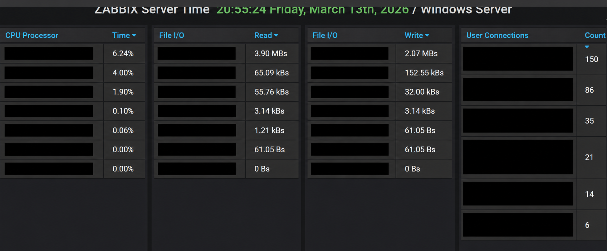
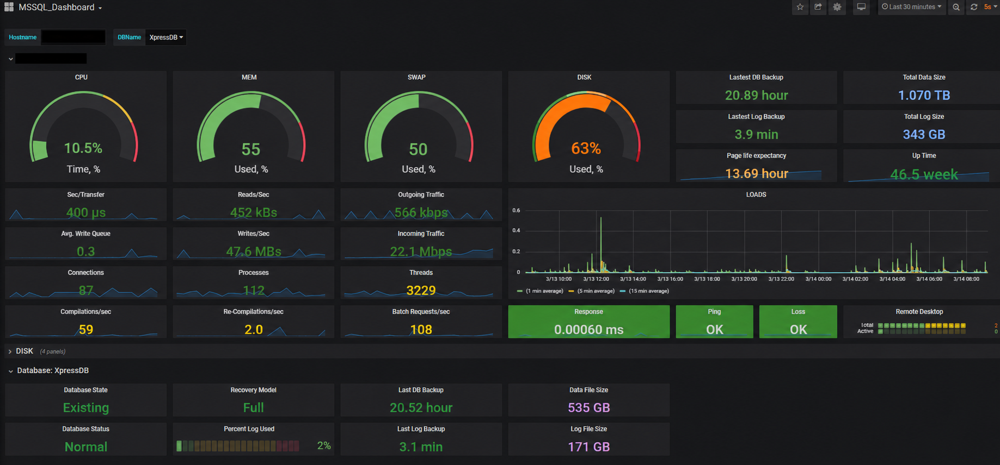
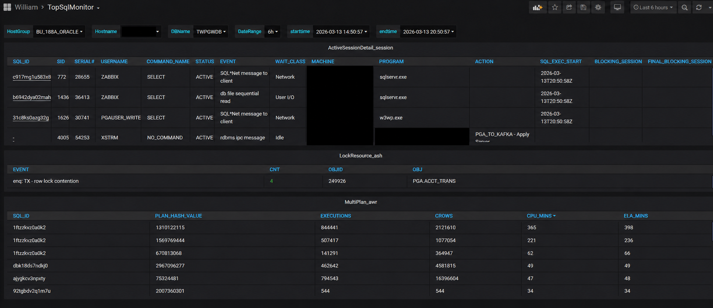

# Grafana 資料庫監控專案

William｜DBA 面試作品集

## 專案介紹

將主機與資料庫的監控資訊集中到 Grafana，方便日常巡檢。發生異常時，可以先找出有問題的主機，再深入查看資料庫與 SQL 狀況。

## 負責的工作

- **Grafana 面板**：設計監控畫面，集中呈現重要資訊。
- **SQL 指標查詢**：撰寫 SQL，取得資料庫狀態與效能資料。
- **告警設定**：設定異常通知，提醒維運人員處理。
- **維運排查**：搭配監控資訊，追查效能與連線問題。

## 三個主要監控畫面

### 1. Windows 主機總覽

**用途：一次查看多台主機，找出需要優先檢查的對象。**

- CPU 使用率：查看主機是否忙碌。
- 磁碟讀寫量：查看資料讀寫的負載。
- 使用者連線數：觀察連線是否明顯增加。

巡檢時先比較各台主機；發現數值明顯變化，再查看歷史趨勢與資料庫狀態。

### 2. SQL Server 健康監控

**用途：確認主機資源、資料庫容量與備份狀況。**

- CPU、記憶體與磁碟使用率。
- 資料庫連線數與查詢工作量。
- 資料檔、交易紀錄檔的大小與使用情形。
- 距離上次資料庫備份、交易紀錄備份的時間。

可以依主機與資料庫切換畫面，集中檢查資源與備份資訊。備份是否正常，仍需搭配備份紀錄與還原測試確認。

### 3. Oracle SQL 監控

**用途：資料庫變慢時，協助找出需要追查的 SQL 與等待原因。**

- 查看目前執行中的連線與 SQL。
- 查看等待事件，了解 SQL 正在等待什麼。
- 查看鎖定與阻塞資訊，追查是否有交易互相等待。
- 查看同一 SQL 的不同執行計畫，作為效能分析的線索。

發現可疑 SQL 後，再確認執行計畫、等待原因與資源消耗，縮小問題範圍。

## 專案帶來的幫助

- **集中巡檢**：在同一套監控介面查看多台主機與資料庫。
- **協助排查**：從主機資源一路追查到資料庫與 SQL。
- **方便溝通**：使用相同畫面，與系統及開發人員討論問題。

## Dashboard介紹

我負責資料庫監控報表，包含面板設計、SQL 查詢、告警設定及維運排查。

主要有三個畫面：第一個是多台 Windows 主機總覽，第二個是 SQL Server 的資源、容量與備份監控，第三個是 Oracle 的 SQL、等待事件與鎖定分析。

這套監控的幫助是讓日常巡檢更集中，發生異常時，也能從主機一路往資料庫與 SQL 追查，協助縮小問題範圍。
