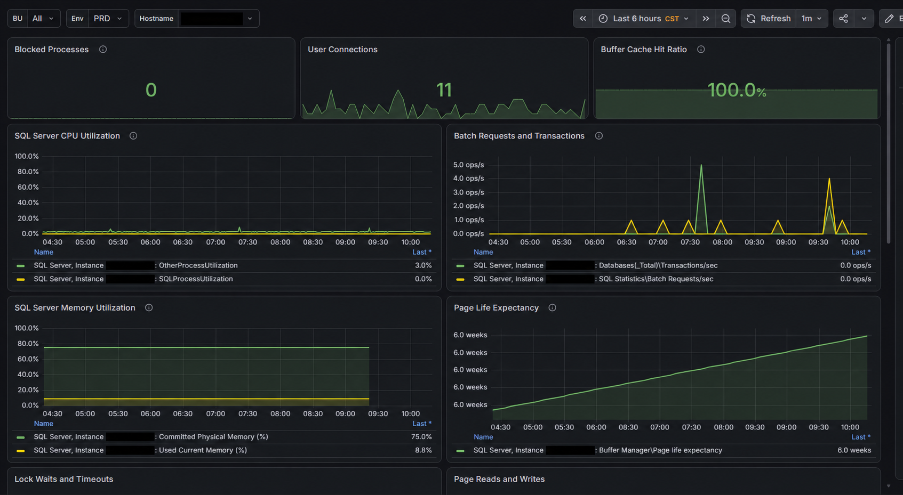
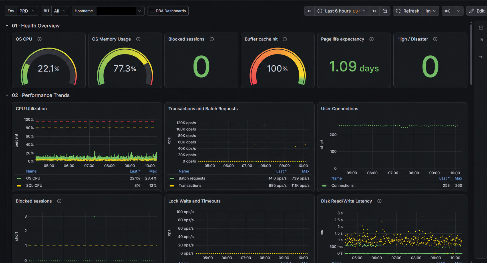

# Grafana 資料庫監控專案

William｜DBA 面試作品集

## 專案介紹

將主機與資料庫的監控資訊集中到 Grafana，方便日常巡檢。發生異常時，可以先找出有問題的主機，再深入查看資料庫與 SQL 狀況。

## 負責的工作

- **Grafana 面板**：設計監控畫面，集中呈現重要資訊。
- **SQL 指標查詢**：撰寫 SQL，取得資料庫狀態與效能資料。
- **告警設定**：設定異常通知，提醒維運人員處理。
- **維運排查**：搭配監控資訊，追查效能與連線問題。

## 三個主要監控畫面

### 1. BU Dashboard

**用途：依 BU、環境與主機篩選，查看 SQL Server 的運作狀況。**

- 查看阻塞數量、使用者連線數與快取命中率。
- 比較 CPU、記憶體、交易量與查詢量的變化。
- 透過時間趨勢，觀察負載是否明顯增加。

### 2. DBA Dashboard

**用途：將健康總覽與效能趨勢放在同一頁，方便 DBA 巡檢與排查。**

- 先查看 CPU、記憶體、阻塞與高嚴重度告警數量。
- 再查看交易量、連線數及鎖定等待的變化。
- 搭配磁碟讀寫延遲，縮小需要追查的問題範圍。

### 3. Oracle SQL 監控

**用途：資料庫變慢時，協助找出需要追查的 SQL 與等待原因。**

- 查看目前執行中的連線與 SQL。
- 查看等待事件，了解 SQL 正在等待什麼。
- 查看鎖定與阻塞資訊，追查是否有交易互相等待。
- 查看同一 SQL 的不同執行計畫，作為效能分析的線索。

發現可疑 SQL 後，再確認執行計畫、等待原因與資源消耗，縮小問題範圍。

## 專案帶來的幫助

- **集中巡檢**：在同一套監控介面查看多台主機與資料庫。
- **協助排查**：從主機資源一路追查到資料庫與 SQL。
- **方便溝通**：使用相同畫面，與系統及開發人員討論問題。

## Dashboard介紹

我負責資料庫監控報表，包含面板設計、SQL 查詢、告警設定及維運排查。

監控畫面包含 BU Dashboard、DBA Dashboard 與 Oracle SQL 監控。可以依使用情境，從整體狀態逐步查看效能細節。

這套監控的幫助是讓日常巡檢更集中，發生異常時，也能從主機一路往資料庫與 SQL 追查，協助縮小問題範圍。
